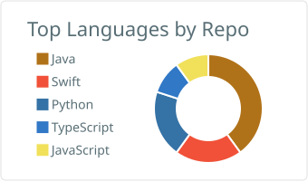
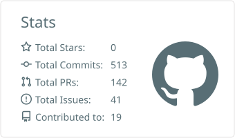

  

  

## 👀 About Me
**A developer who works across the stack — from backend to deployment and operations.**

* ⚙️ **Backend** — API and service development with Spring Boot and ASP.NET Core
* ☁️ **Infrastructure** — Building and operating container and virtualization environments with Kubernetes, Harbor, VMware, VDI, and Linux
* 🏢 **Currently** — ERP development
* 🌱 **Focus** — Backend + cloud infrastructure
* 🌐 **Portfolio** — https://dlwldp.github.io

 

## 💼 Experience
* 🎓 **Hansung University** — Mobile Software & Big Data · Graduated `2026.02`

 

## 🧱 Tech Stack

### Backend

### Cloud · Infrastructure

### Frontend · Data

 

## 🚀 Projects

### 💸 [AWS 얼마야? (How Much on AWS?)](https://github.com/dlwldP/Awscal) — AWS Cost Calculator for Beginners `2026.10`
> Pick what you want to build and compare AWS setups with estimated monthly costs. · [Try it](https://dlwldp.github.io/Awscal/?utm_source=github-profile)
* Itemized cost comparison with warnings for hidden charges (NAT Gateway, public IPv4, data transfer, etc.)
* Weekly price updates via the AWS Price List API, automated with GitHub Actions
* `JavaScript` `Python` `GitHub Actions` `GitHub Pages`

### 🤖 [AI 뭐 써? (Which AI?)](https://github.com/dlwldP/which-ai) — AI Tools Organized by Use Case `2026.10`
> 290+ AI tools sorted by what you want to do, showing whether each is free and how to use it. · [Try it](https://dlwldp.github.io/which-ai/?utm_source=github-profile) · [For developers](https://dlwldp.github.io/which-ai/dev/?utm_source=github-profile)
* Pricing taken only from official pages, verified by a script against the source text
* Weekly GitHub Actions checks for stale entries and broken links
* `JavaScript` `GitHub Actions` `GitHub Pages`

### 🔍 [KubeLens](https://github.com/dlwldP/KubeLens) — Natural-Language Kubernetes Troubleshooting Agent `2026.10`
> Ask "Why does this pod keep dying?" and get evidence-backed root-cause candidates — read-only.
* Read-only enforced by RBAC and a get/list-only tool layer; every claim must cite a real tool call
* Evaluation harness that reproduces 6 failure types on a kind cluster and scores accuracy
* `LangGraph` `FastAPI` `React` `kind` `GitHub Actions`

### 📈 [stock-monitor](https://github.com/dlwldP/stock-monitor) — Watchlist Alerts · Portfolio Dashboard `2026.08`
* 6 alert rules delivered via Discord, email, or in-app; Mock/real API split so it runs without keys
* `Spring Boot` `Java` `Brokerage Open API`

### 🏠 SWYP Web Cohort 13 — Rental Contract Checklist Service `2026.03 – 05` · Team Project
* Built OAuth2 social login (Naver, Google) with JWT, and AWS EC2 deployment infrastructure
* `Spring Boot` `AWS` · [Visit the service](https://bangcheck.site)

 

## ✍️ Latest Blog Posts
<!-- BLOG-POST-LIST:START -->
- [AI 뭐 써? 4편&lpar;마지막&rpar; — 첫 사용자 리뷰: &quot;그래서 뭘 쓰라는 거예요?&quot;에 답한 한 줄](https://velog.io/@jiye_1124/AI-%EB%AD%90-%EC%8D%A8-4%ED%8E%B8%EB%A7%88%EC%A7%80%EB%A7%89-%EC%B2%AB-%EC%82%AC%EC%9A%A9%EC%9E%90-%EB%A6%AC%EB%B7%B0-%EA%B7%B8%EB%9E%98%EC%84%9C-%EB%AD%98-%EC%93%B0%EB%9D%BC%EB%8A%94-%EA%B1%B0%EC%98%88%EC%9A%94%EC%97%90-%EB%8B%B5%ED%95%9C-%ED%95%9C-%EC%A4%84)
- [AI 뭐 써? 3편 — 점수를 버리고, 추천을 버리고, AI 294개를 모으기까지](https://velog.io/@jiye_1124/AI-%EB%AD%90-%EC%8D%A8-3%ED%8E%B8-%EC%A0%90%EC%88%98%EB%A5%BC-%EB%B2%84%EB%A6%AC%EA%B3%A0-%EC%B6%94%EC%B2%9C%EC%9D%84-%EB%B2%84%EB%A6%AC%EA%B3%A0-AI-294%EA%B0%9C%EB%A5%BC-%EB%AA%A8%EC%9C%BC%EA%B8%B0%EA%B9%8C%EC%A7%80)
- [# &quot;AWS 얼마야?&quot; 4편 — 읽기 쉽게 다듬고, v2 로드맵을 끝내다](https://velog.io/@jiye_1124/AWS-%EC%96%BC%EB%A7%88%EC%95%BC-4%ED%8E%B8-%EC%9D%BD%EA%B8%B0-%EC%89%BD%EA%B2%8C-%EB%8B%A4%EB%93%AC%EA%B3%A0-v2-%EB%A1%9C%EB%93%9C%EB%A7%B5%EC%9D%84-%EB%81%9D%EB%82%B4%EB%8B%A4)
- [# &quot;AWS 얼마야?&quot; 3편 — 숫자를 검증하고, 화면을 비우고, 피드백 하나를 기능으로](https://velog.io/@jiye_1124/AWS-%EC%96%BC%EB%A7%88%EC%95%BC-3%ED%8E%B8-%EC%88%AB%EC%9E%90%EB%A5%BC-%EA%B2%80%EC%A6%9D%ED%95%98%EA%B3%A0-%ED%99%94%EB%A9%B4%EC%9D%84-%EB%B9%84%EC%9A%B0%EA%B3%A0-%ED%94%BC%EB%93%9C%EB%B0%B1-%ED%95%98%EB%82%98%EB%A5%BC-%EA%B8%B0%EB%8A%A5%EC%9C%BC%EB%A1%9C)
- [오픽 2주 준비로 IH 받은 후기 &lpar;공부법 + 시험장 팁&rpar;](https://velog.io/@jiye_1124/%EC%98%A4%ED%94%BD-2%EC%A3%BC-%EC%A4%80%EB%B9%84%EB%A1%9C-IH-%EB%B0%9B%EC%9D%80-%ED%9B%84%EA%B8%B0-%EA%B3%B5%EB%B6%80%EB%B2%95-%EC%8B%9C%ED%97%98%EC%9E%A5-%ED%8C%81)
<!-- BLOG-POST-LIST:END -->

➡️ [See more posts](https://velog.io/@jiye_1124/posts)

 

## 📊 GitHub Stats

<picture>
  <source media="(prefers-color-scheme: dark)" srcset="https://raw.githubusercontent.com/dlwldP/dlwldP/output/github-snake-dark.svg" />
  
</picture>

 

## 📊 AI Token Usage

  

 

## 📬 Contact
* 📧 Email — jiye7961@gmail.com
* 🌐 Portfolio — https://dlwldp.github.io
* 🎯 Tech Blog — https://velog.io/@jiye_1124/posts

  

